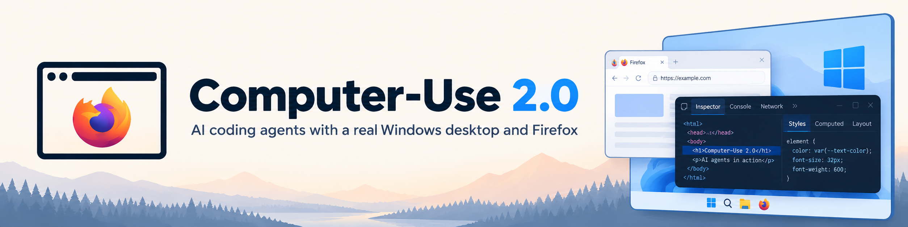

<p align="center">
  
</p>

# Computer-Use 2.0

**Give your coding agent a real Firefox debugging session and Windows desktop tools.** Inspect a page, follow its console and network activity, and operate the application you choose—all through a local MCP server.

[Get started](#get-started) · [VS Code setup](docs/getting-started.md#codex-in-vs-code) · [Firefox guide](firefox/README.md) · [Windows guide](native/README.md) · [Validation](docs/final-validation.md)

## Start with a problem

> “This page gets stuck after a refresh. Monitor its console and network requests, compare a fresh tab, and explain what is failing before changing anything.”

Computer-Use 2.0 gives the agent the tools to investigate that request: select the page, attach Firefox's native diagnostics, reproduce the issue, inspect the DOM and JavaScript, and compare the result with the visible interface.

In a real signed-in browser test, those tools exposed a missing `window.performance` object and repeated startup errors in a stalled page. A fresh tab loaded with the same extensions and userscript settings. That established a useful diagnostic comparison without changing the user's configuration. It did not establish the exact intermittent trigger or a permanent fix.

**Verified locally:** Firefox launch and approval, tab discovery, DOM/CSS inspection, console messages, source listings, captured network traffic, and opening the visible DevTools Console. Codex in VS Code separately confirmed the native helper, Firefox connection, and tab listing. [See the evidence and limits →](docs/final-validation.md)

## Two ways to inspect the same application

| Firefox debugging | Windows desktop control |
| --- | --- |
| DOM and computed CSS | Window and application discovery |
| Native console messages and errors | Accessibility trees and screenshots |
| Captured requests and response bodies | Clicks, keyboard input and Unicode typing |
| JavaScript sources and flat v3 source maps | Editable values, scrolling and dragging |
| Breakpoints, paused frames and stepping | Owned dialogs and visible DevTools controls |

**51 MCP tools:** 35 Firefox tools, 14 Windows tools, and 2 status/cancellation tools. The Windows set contains status plus thirteen desktop operations.

Firefox connects directly through its Remote Debugging Protocol. The Windows helper uses UI Automation, Windows Graphics Capture, and native input APIs. No Firefox add-on or extension signing is required, and the runtime has no npm package dependencies.

## Get started

Build on **Windows x64** with **Node.js 24+** and the **.NET 10 SDK with Windows Desktop targeting support**. Firefox is needed for browser debugging. The tested protocol baseline is Firefox 159.0; compatibility with every future Firefox version is not guaranteed.

```powershell
git clone https://github.com/gonzoinc/computer_use_2.0.git
cd computer_use_2.0
powershell -NoProfile -File scripts/build.ps1 -Test -Package
```

This builds the native helper, runs the default checks, and prepares a local plugin marketplace under `.codex/marketplace`. Default tests do not launch Firefox or control existing user windows.

### Codex desktop plugin

From the repository folder:

```powershell
codex plugin marketplace add "$PWD\.codex\marketplace"
codex plugin add computer-use-2@computer-use-2-local
```

Restart Codex and enable **Computer-Use 2.0** for the chat or project. Ask the agent to call `computer_use_status` first.

### Codex in VS Code

The IDE extension uses a direct MCP connection. After building, register the packaged server:

```powershell
$server = Join-Path $PWD '.codex\marketplace\plugins\computer-use-2\runtime\server.mjs'
codex mcp add computer_use_2_local -- node $server
```

Reload VS Code and ask Codex to call `computer_use_status` on `computer_use_2_local`. [Install the usage skill and check the full setup →](docs/getting-started.md#codex-in-vs-code)

## Your first Firefox session

1. Ask the agent to list available profiles, then select the profile you want to use.
2. If setup is needed, close that profile normally before explicitly enabling its debugging preferences.
3. Ask the agent to launch that profile with debugging on port `6000`, or connect if it is already listening there.
4. Approve Firefox's debugging prompt. The agent polls connection status, lists tabs, and selects the page you designate.

**Connect does not launch Firefox.** Launch and connection return a pending state first; the agent must wait for confirmed readiness before inspecting a tab. Firefox's striped address bar indicates that remote debugging is active.

## Observe → act → check

For desktop input, the agent selects an observed window, obtains a fresh snapshot, performs one action, and observes again. Coordinate input also requires the matching screenshot. Typing verifies the current focused element; input stops when the target or focus cannot be verified.

Cancellation and physical **Escape** stop active work. A cancelled or timed-out action may have partly completed, so the agent must inspect the result before continuing. Disconnecting releases the plugin's own connection and helper without closing the user's Firefox.

## Troubleshooting

| Symptom | What to check |
| --- | --- |
| Firefox connection fails before TCP connects | Firefox must be running with the debugging listener enabled on the chosen port. |
| Connection stays pending | Check Firefox's own approval prompt, then poll status instead of starting another connection. |
| Windows input is refused | Bring the selected application to the foreground, then obtain a new snapshot. Replying in chat can move focus away from it. |
| Plugin update reports a file in use | Fully quit Codex before removing and reinstalling its cached plugin. |
| VS Code does not show the tools | Reload the window; confirm the MCP entry and server path in the active Windows configuration. |

[Detailed setup, updates, and removal →](docs/getting-started.md)

## Compatibility and development

Windows 10 version 2004+ supplies the required capture APIs. Installed bundles require Node.js and the .NET 10 Windows Desktop runtime. Native desktop control requires a local interactive Windows session; WSL, SSH, or containers need a suitable local Windows executor.

Protected or minimized windows, elevated applications, mixed-DPI setups, and individual accessibility providers can limit capture or input. PrintWindow fallback is explicitly identified and can miss GPU content. Indexed source maps and binary RDP bulk transfers are unsupported. Network observation is not a guarantee of complete historical traffic.

```powershell
npm test
node scripts/validate-package.mjs
node scripts/smoke-staged.mjs
```

Builds, schema caches, and diagnostic material remain inside the ignored `.codex/` directory. The source tree contains the independent implementation; proprietary OpenAI source and binaries are not included. [Architecture and original capability analysis →](docs/original-analysis.md)

## License

[MIT](LICENSE). Microsoft SDK components retain their own license and attribution requirements; packaged bundles include third-party notices. This is an independent project and is not affiliated with OpenAI, Mozilla, or Microsoft.
